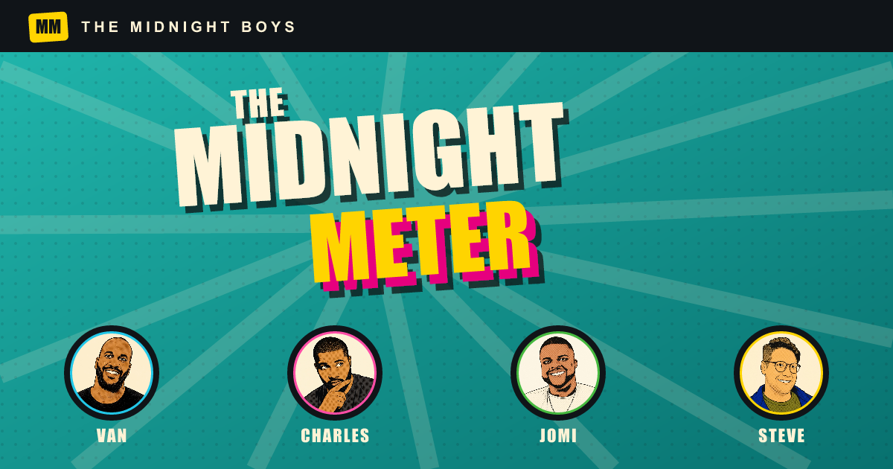

# Midnight Meter

Midnight Meter is an interactive archive of every movie and television rating given by Van Lathan, Charles Holmes, Jomi Adeniran, and Steve Ahlman on *The Midnight Boys* podcast.

[View the live site](https://midnightmeter.vercel.app)

## The project

I designed and built Midnight Meter to turn years of podcast ratings into a searchable, visual record. The archive brings together more than 100 verdicts from 2021–2026 and gives each host a living statistical profile instead of presenting the data as a simple list.

The interface is inspired by the show's comic-book energy: bold condensed type, halftone textures, high-contrast color, illustrated host cards, and a custom 1–12 rating meter. It is fully responsive and designed to feel at home on both phones and larger screens.

## Highlights

- Searchable archive with Film and Series filters, multiple sort modes, and expandable rating details
- Host profiles with career averages, generosity rankings, score distributions, and highest and lowest verdicts
- **Midnight Mulligans** mode that applies the hosts' year-end rating revisions and recalculates rankings and statistics across the entire site
- Source episode links for tracing ratings back to the original conversation
- Downloadable 1080 × 1920 rating cards rendered with bundled fonts for consistent sharing across browsers and deployment environments
- Keyboard support, reduced-motion handling, responsive layouts, and mobile-specific interaction polish

## Engineering

The data layer combines a historical archive with manually verified podcast entries, then derives host statistics and rankings from whichever score set—original or Mulligans—is active. Search normalization handles punctuation and diacritics, while the share-card renderer uses Resvg and OpenType font paths to produce consistent PNGs without relying on browser screenshots.

Built with SvelteKit, TypeScript, Vite, Resvg, and self-hosted typography. Deployed continuously from GitHub to Vercel.

## Note

Midnight Meter is an independent fan project and is not affiliated with The Ringer, Spotify, or the hosts of *The Midnight Boys*. The podcast episodes are the source of record.
